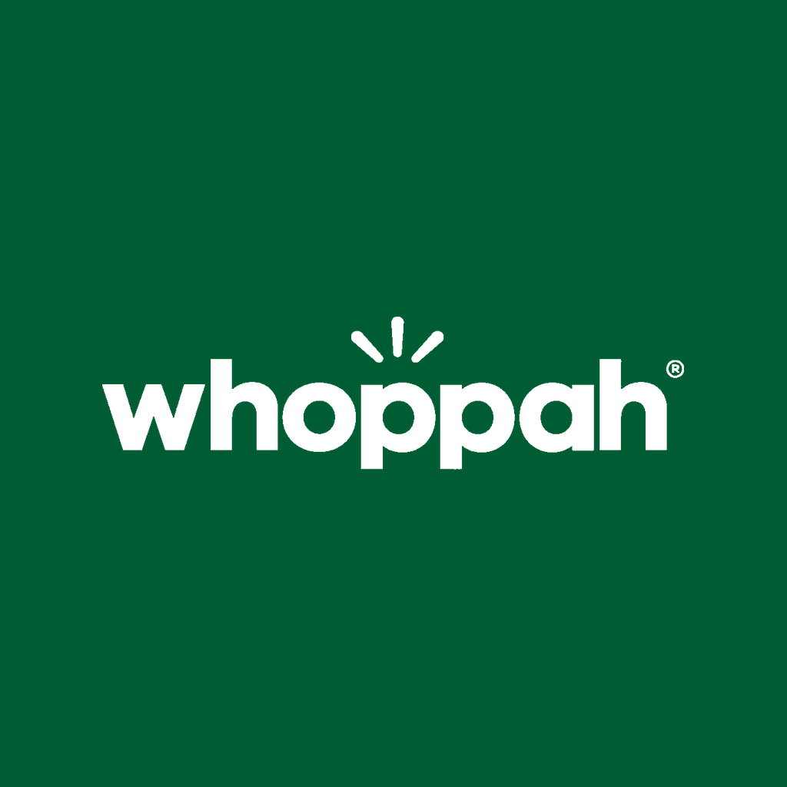

# Whoppah plugin

Find curated second-hand design from your AI assistant. This plugin connects Cursor, Grok Bot and other MCP-capable agents to [Whoppah](https://www.whoppah.com), the Amsterdam marketplace for pre-owned furniture, lighting, art, decor and designer bags.

Every answer is based on live listings: what is for sale right now, at what price, in what condition, and what delivery to your country costs. Buying, payment and buyer protection happen on whoppah.com, through the link that comes with every listing.

## What's inside

| Path | What it is |
|---|---|
| `.cursor-plugin/plugin.json` | Plugin manifest |
| `mcp.json` | Connection to the hosted Whoppah MCP server at `https://mcp.whoppah.com/mcp` |
| `skills/find-second-hand-design/SKILL.md` | How the agent should search, compare and present Whoppah listings |
| `assets/logo.png` | Logo |

The plugin is configuration only: it contains no code and needs no API key.

## Tools

The server exposes seven read-only tools. No account or sign-in is needed.

| Tool | What it does |
|---|---|
| `search_catalog` | Search live listings by keyword, with filters for category, brand, designer, price, condition, colour, material and seller country |
| `get_item` | One listing's description, dimensions, condition, materials and photos |
| `similar_items` | Pieces that look and read like a given listing |
| `get_seller_profile` | Whether a seller is private or a business, expert status and reviews |
| `list_brands_designers` | Whoppah's brand and designer index, for exact filters |
| `list_categories` | The category tree |
| `shipping_quote` | Delivery and pickup options and prices for a listing to a country |

## Try it

- "Find me a second-hand Vitra chair under €500."
- "Show me a USM Haller sideboard on Whoppah with its exact dimensions, condition and photos."
- "I like the Gubi Beetle chair. Find similar pieces on Whoppah, preferably cheaper."
- "What does delivery of an Artemide lamp from Whoppah to Germany cost?"

## Other assistants

Any client that supports remote MCP servers over streamable HTTP can use the server directly: add `https://mcp.whoppah.com/mcp` with no authentication.

## Privacy and limits

- The tools return public listing information only. They never return a seller's or buyer's name, contact details or address.
- The plugin cannot place orders, take payments, make offers or message sellers. Those steps happen on whoppah.com.
- Every listing is a one-off, so availability can change at any moment. Prices are in EUR.

## Links

- Website: https://www.whoppah.com
- For agents: https://www.whoppah.com/agents
- Terms: https://www.whoppah.com/terms
- Privacy policy: https://www.whoppah.com/privacy-policy
- Support: https://www.whoppah.com/contact-us

## Licence

The files in this repository are available under the [MIT License](LICENSE). The Whoppah name and logo are trademarks of Whoppah B.V., and use of the hosted service is subject to the [Whoppah terms](https://www.whoppah.com/terms).
